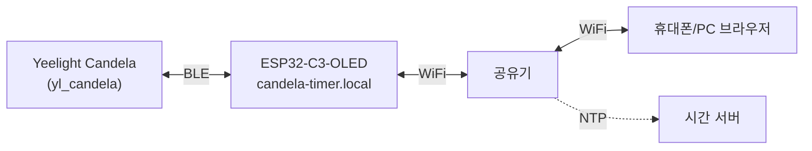
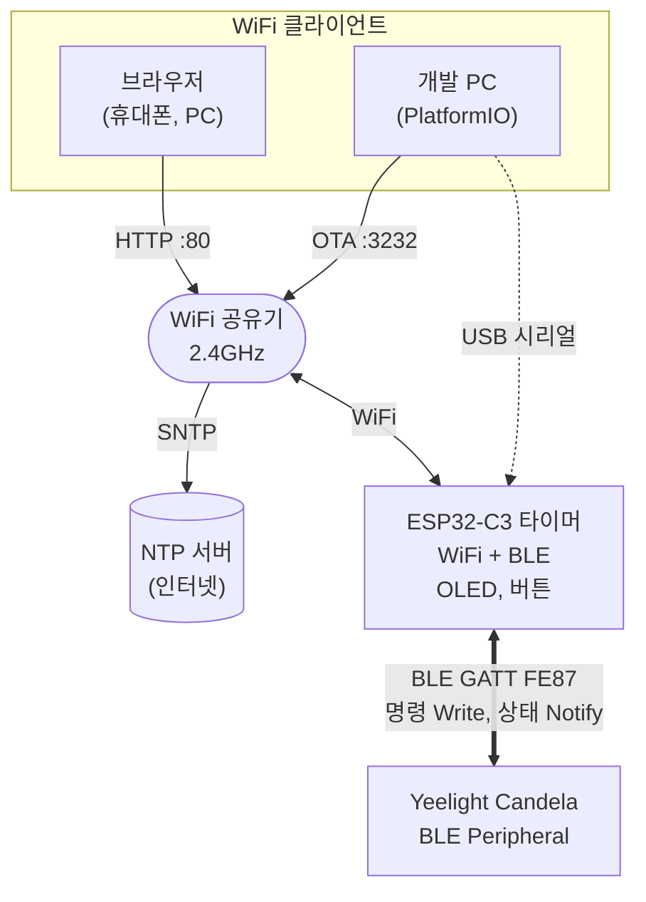
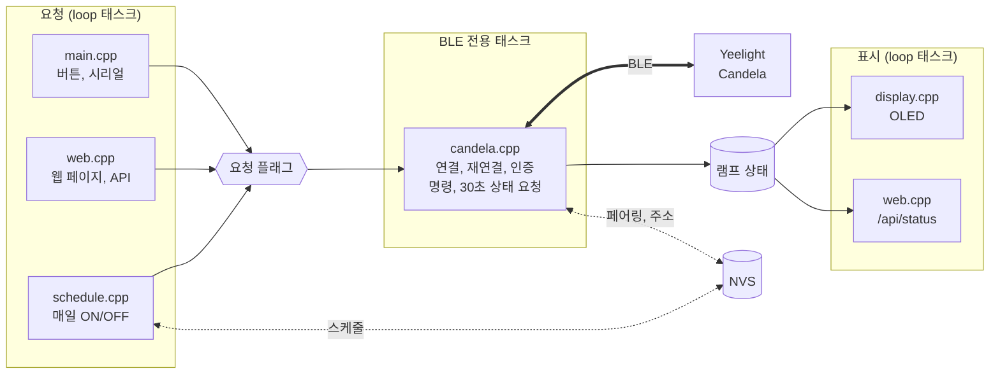
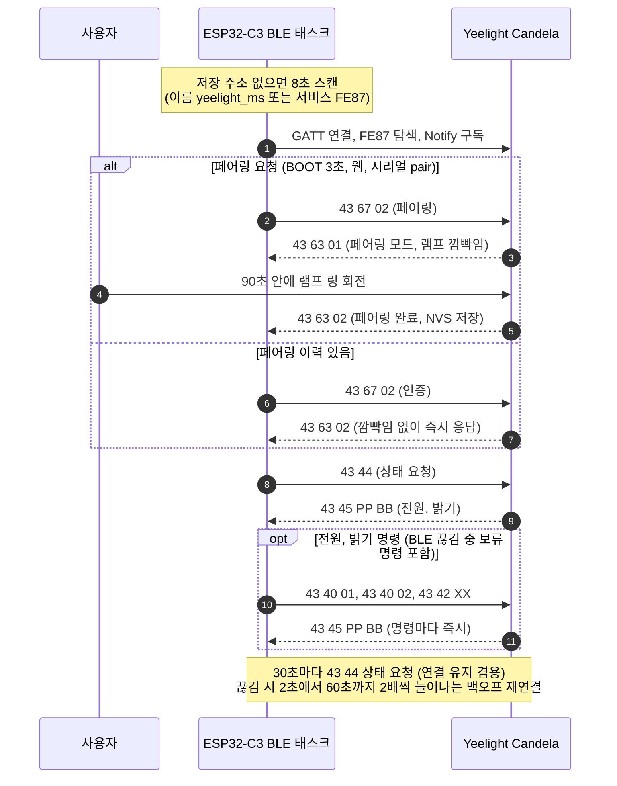

<div align="center">

# `esp32-yeelight-timer`

**Yeelight Candela BLE 램프용 단독 타이머.**<br/>
ESP32-C3 보드 하나로 매일 정해진 시각에 램프 켜기와 끄기. Home Assistant, 클라우드, 앱 불필요.

[](LICENSE)
[](https://platformio.org)
[](#2-하드웨어)
[](https://github.com/h2zero/NimBLE-Arduino)

<br/>

```bash
git clone https://github.com/hungryZoo/esp32-yeelight-timer
```


</div>

---

* 전원 연결 후 WiFi 연결, NTP 시각 동기화, Candela BLE 연결.
* 이후 매일 ON 시각에 램프 켜기, OFF 시각에 램프 끄기 반복.
* 0.42인치 OLED에 현재 시각, 다음 예약, 연결 상태, IP 표시.
* 같은 WiFi의 브라우저에서 `http://candela-timer.local` 접속으로 전원, 밝기, 스케줄, 페어링 제어.
BLE 끊김 시 자동 재연결, 펌웨어 갱신은 WiFi OTA 지원.


<div align="center">


https://github.com/user-attachments/assets/812b299f-034d-4afa-9b6c-550d706befb8


https://github.com/user-attachments/assets/d2e4e14f-0797-406d-89de-95b24b96933b


</div>

---

## 목차

1. [개요](#1-개요)
   - [기능](#기능)
   - [시스템 구성](#시스템-구성)
   - [펌웨어 구조](#펌웨어-구조)
   - [동작 방식](#동작-방식)
2. [하드웨어](#2-하드웨어)
   - [준비물](#준비물)
   - [핀 배치](#핀-배치)
3. [설치](#3-설치)
   - [PlatformIO 설치](#platformio-설치)
   - [WiFi 정보 입력](#wifi-정보-입력)
   - [첫 업로드 (USB)](#첫-업로드-usb)
   - [OTA 업로드](#ota-업로드)
4. [빠른 시작](#4-빠른-시작)
5. [사용법](#5-사용법)
   - [OLED 화면](#oled-화면)
   - [BOOT 버튼](#boot-버튼)
   - [웹 제어 페이지](#웹-제어-페이지)
   - [시리얼 명령](#시리얼-명령)
   - [웹 API](#웹-api)
6. [설정](#6-설정)
   - [config.h](#configh)
   - [secrets.h](#secretsh)
7. [Candela BLE 프로토콜](#7-candela-ble-프로토콜)
   - [GATT 구성](#gatt-구성)
   - [명령](#명령)
   - [알림](#알림)
   - [연결 순서](#연결-순서)
   - [실측 동작](#실측-동작)
8. [개발](#8-개발)
   - [저장소 구성](#저장소-구성)
   - [로그와 도구](#로그와-도구)
   - [문제 해결](#문제-해결)
9. [라이선스](#9-라이선스)

---

## 1. 개요

Yeelight Candela는 WiFi 없이 BLE로만 제어되는 램프.
이 프로젝트는 ESP32-C3가 램프에 직접 BLE로 연결해 예약 동작을 수행하는 단독 장치 구성.

### 기능

- **매일 반복 스케줄**: ON 시각, OFF 시각, ON 시 밝기 지정. 자정 넘김 구간(예: 17:50 ON, 07:30 OFF) 지원, 같은 분 중복 전송 방지.
- **부팅 구간 판정**: 재부팅 시점이 ON 구간 안이면 시각 확보 직후 1회 켜기.
- **단독 동작**: Home Assistant, 클라우드, 제조사 앱 없이 ESP32-C3와 램프만으로 동작. 인터넷은 NTP 시각 동기화에만 사용.
- **BLE 자동 재연결**: 전용 FreeRTOS 태스크에서 연결 관리. 2초에서 60초까지 2배씩 늘어나는 백오프, 연결마다 인증 자동 전송.
- **명령 보류 전송**: BLE 끊김 중 받은 전원, 밝기 명령은 보관 후 재연결 시 전송.
- **OLED 상태 표시**: 현재 시각, 다음 예약, BLE 상태, 램프 전원, IP. 저휘도(contrast 8/255)와 3분 주기 0-2px 위치 이동으로 번인 방지.
- **웹 제어 페이지**: 전원, 밝기, 스케줄, 페어링, 로그, 재부팅. 모바일 화면과 다크 모드 지원, 외부 리소스 없는 단일 HTML.
- **BOOT 버튼**: 짧게 눌러 전원 토글, 3초 유지로 페어링 시작.
- **WiFi OTA**: ArduinoOTA 비밀번호 인증 기반 무선 펌웨어 갱신.
- **설정 유지**: 스케줄, 페어링 이력, 램프 주소를 NVS에 저장. 펌웨어 갱신 후에도 유지.

### 시스템 구성

ESP32-C3가 WiFi 쪽(브라우저, OTA, NTP)과 BLE 쪽(Candela) 사이 중계 담당. 램프와의 연결은 BLE 단일 경로.



### 펌웨어 구조

BLE 통신은 전용 FreeRTOS 태스크에서만 수행. 웹, 버튼, 스케줄, 시리얼은 요청 플래그만 설정하므로 BLE 연결 대기 중에도 다른 기능이 멈추지 않는 구조.



### 동작 방식

| 상황 | 동작 |
| --- | --- |
| ON 시각 도달 | 켜기 명령. ON 시 밝기가 1-100이면 밝기 명령 추가 |
| OFF 시각 도달 | 끄기 명령 |
| ON 구간 중 부팅 | 시각 확보 직후 켜기 1회 |
| OFF 구간 중 부팅 | 동작 없음 (램프 상태 유지) |
| 스케줄 활성화 또는 시각 변경 시 현재가 ON 구간 | 즉시 켜기 |
| BLE 끊김 중 명령 수신 | 보관 후 재연결 시 전송 |
| WiFi 끊김 | 내부 시계 기준 스케줄 계속 동작, 15초 주기 재연결 |
| 소프트 리셋 (OTA, 재부팅) | 내부 시계 유지, NTP 전에도 스케줄 동작 |
| 전원 차단 후 재시작 | NTP 동기화 전까지 스케줄 대기 |

부팅 순서는 (1) WiFi (2) NTP (3) OLED (4) NimBLE 4단계 구성.
웹 서버와 OTA는 WiFi 최초 연결 시점에 시작.

<p align="right"><a href="#목차">↑ 맨 위로</a></p>

## 2. 하드웨어

### 준비물

| 부품 | 내용 |
| --- | --- |
| 보드 | ESP32-C3 0.42인치 OLED 내장 개발보드 (SSD1306 72x40, 4MB flash, USB-Serial-JTAG 네이티브 USB) |
| 램프 | Yeelight Candela (BLE 전용, 광고 이름 `yeelight_ms`) |
| 케이블 | USB-C 데이터 케이블 (첫 업로드용) |
| 전원 | USB 5V 어댑터 |
| 네트워크 | 2.4GHz WiFi (ESP32-C3는 5GHz 미지원) |

### 핀 배치

| 기능 | GPIO | 비고 |
| --- | --- | --- |
| OLED SDA | 5 | I2C |
| OLED SCL | 6 | I2C. 핀 미지정 시 C3 기본 SCL이 GPIO9(BOOT 버튼)와 겹치므로 명시 |
| BOOT 버튼 | 9 | active low, 내부 풀업 |

OLED는 U8g2 `SSD1306_72X40_ER` 드라이버 사용. 화면 좌우 잘림 시 `OLED_X_OFFSET`(기본 28)을 29-30으로 조정.
다른 핀 배치의 보드는 [`include/config.h`](include/config.h)의 핀 상수 변경.

<p align="right"><a href="#목차">↑ 맨 위로</a></p>

## 3. 설치

### PlatformIO 설치

```bash
uv tool install platformio
```

VS Code의 PlatformIO IDE 확장 사용도 가능. 라이브러리(NimBLE-Arduino, U8g2)는 첫 빌드 시 자동 설치.

### WiFi 정보 입력

첫 빌드 시 [`tools/check_secrets.py`](tools/check_secrets.py)가 `include/secrets.h`를 점검. 파일이 없거나 예시 값 그대로면 터미널에서 값을 물어보고 파일 자동 작성.

```text
==================================================================
 WiFi 설정 (최초 1회): include/secrets.h 작성
 입력값은 이 컴퓨터의 include/secrets.h 에만 저장 (.gitignore 대상)
==================================================================
WiFi 이름 (2.4GHz SSID): MyHome-2.4G
WiFi 비밀번호 (입력 숨김, 개방형 네트워크는 Enter):
WiFi 비밀번호 확인:
OTA 업로드 비밀번호 (Enter = 자동 생성 Xq3v...):

 -> include/secrets.h 저장 완료, 빌드 계속
```

터미널 입력이 불가능한 환경(CI, 일부 IDE 빌드 버튼)에서는 안내 문구 출력 후 빌드 중단. 이 경우 직접 작성.

```bash
cp include/secrets.h.example include/secrets.h
```

| 점검 항목 | 규칙 |
| --- | --- |
| `WIFI_SSID` | 빈 값, 예시 값(`your-ssid`) 불가. 32바이트 이하 |
| `WIFI_PASSWORD` | 예시 값(`your-password`) 불가. 8-64자, 개방형 네트워크는 빈 문자열 |
| `OTA_PASSWORD` | 빈 값, 예시 값(`change-me`) 불가 |

같은 규칙을 [`src/main.cpp`](src/main.cpp)의 `static_assert`로도 검사해 예시 값으로는 컴파일 불가. 값 변경은 `include/secrets.h` 직접 수정 후 재빌드. 항목은 [secrets.h](#secretsh) 참고.

### 첫 업로드 (USB)

```bash
pio run -t upload
```

USB-Serial-JTAG 자동 다운로드 모드로 BOOT 버튼 조작 불필요.
USB 시리얼 장치가 여러 개면 다른 포트가 선택될 수 있으므로 `--upload-port /dev/cu.usbmodem101`처럼 지정.
업로드 실패가 계속되면 BOOT 버튼을 누른 채 USB 연결 후 재시도.

### OTA 업로드

첫 USB 업로드 이후 WiFi로 갱신.

```bash
pio run -e ota -t upload
```

대상은 `candela-timer.local:3232`. [`tools/ota_auth.py`](tools/ota_auth.py)가 `secrets.h`의 `OTA_PASSWORD`를 espota 인증 값으로 자동 전달.
mDNS 이름 해석 실패 시 `--upload-port <장치 IP>` 지정. 장치 IP는 OLED 맨 아래 줄에 표시.

<p align="right"><a href="#목차">↑ 맨 위로</a></p>

## 4. 빠른 시작

1. `pio run -t upload` 실행 후 터미널 질문에 WiFi 이름, 비밀번호, OTA 비밀번호 입력 (최초 1회).
2. WiFi 연결과 NTP 동기화(최대 약 20초 대기) 후 OLED에 현재 시각 표시.
3. 램프 주소 자동 탐색. 광고 이름 `yeelight_ms` 또는 서비스 FE87을 8초간 스캔, 발견 주소 NVS 저장.
4. 최초 1회 페어링. BOOT 버튼 3초 유지 → OLED `PAIRING / TURN THE RING` 표시와 램프 깜빡임 → 90초 안에 램프 링 회전 → 페어링 완료.
5. 브라우저에서 `http://candela-timer.local` 접속 후 스케줄 설정.

페어링 전에도 명령은 동작하나 약 28초마다 BLE 연결 끊김. 페어링 후 연결 유지, 이후 재연결마다 깜빡임 없이 자동 인증.

<p align="right"><a href="#목차">↑ 맨 위로</a></p>

## 5. 사용법

### OLED 화면

| 줄 | 내용 | 표시 예 |
| --- | --- | --- |
| 1 | 현재 시각 (KST) | `17:50`, 시각 미확보 시 `--:--` |
| 2 | 다음 예약 | `OFF 07:30`, 스케줄 꺼짐 시 `SCHED OFF`, 시각 미확보 시 `NO TIME` |
| 3 | BLE 상태와 램프 전원 | `BLE OK` + 채운 원(켜짐) 또는 빈 원(꺼짐) |
| 4 | 장치 IP | `192.168.0.10`, WiFi 끊김 시 `NO WIFI` |

| BLE 표시 | 의미 |
| --- | --- |
| `OK` | 램프 연결됨 |
| `X` | 끊김, 재연결 대기 또는 시도 중 |
| `PAIR` | 페어링 진행 중 |

기본 화면 대신 표시되는 화면은 OTA 진행률(`OTA nn%`와 진행 막대), 버튼 유지 중 카운트다운(`HOLD / PAIR IN 2s`), 페어링 대기(`PAIRING / TURN THE RING`) 3종.

### BOOT 버튼

| 조작 | 동작 |
| --- | --- |
| 짧게 누름 (손 뗄 때) | 램프 전원 토글 |
| 0.5초 이상 유지 | OLED에 페어링까지 남은 초 표시 |
| 3초 유지 | 페어링 시작 (손 떼기 전 즉시 실행) |

### 웹 제어 페이지

<!-- TODO: 웹 페이지 스크린샷 (docs/images/web.png 추가 또는 GitHub 업로드 주소로 교체) -->
<p align="center"></p>

`http://candela-timer.local` 또는 `http://<장치 IP>` 접속. 2초 주기로 상태 갱신.

| 카드 | 기능 |
| --- | --- |
| 램프 | 전원 버튼, 밝기 슬라이더(1-100%), 10%, 30%, 60%, 100% 단축 버튼. BLE 끊김 중에는 보류 명령 표시 |
| 스케줄 | 사용 스위치(즉시 저장), ON 시각, OFF 시각, ON 시 밝기(0 = 기존 밝기 유지), 다음 예약과 최근 동작 |
| 연결 | BLE 상태, 연결 시간, RSSI, 페어링 여부, 연결과 끊김 횟수, 램프 주소, WiFi IP와 RSSI. 페어링 버튼, 램프 상태 새로고침 버튼 |
| 로그 | 최근 60줄 로그 (펼침 시 자동 스크롤), 가동 시간, 여유 메모리, 마지막 NTP 동기화, 재부팅 버튼 |

### 시리얼 명령

USB 시리얼 115200 baud, 줄바꿈으로 명령 구분.

| 명령 | 동작 |
| --- | --- |
| `on`, `off`, `toggle` | 램프 전원 |
| `b <1-100>` | 밝기 (꺼진 상태면 켜짐) |
| `pair` | 페어링 시작 |
| `status` | 램프 상태 요청 |
| `info` | 장치 상태 요약 로그 |
| `scan` | 저장된 램프 주소 삭제 후 재탐색 |
| `forget` | 페어링 이력 삭제 |
| `sched` | 현재 스케줄 표시 |
| `sched on HH:MM`, `sched off HH:MM` | ON, OFF 시각 변경 |
| `sched bri <0-100>` | ON 시 밝기 (0 = 유지) |
| `sched enable`, `sched disable` | 스케줄 사용 여부 |
| `reboot` | 재부팅 |

### 웹 API

| 메서드 | 경로 | 파라미터 |
| --- | --- | --- |
| GET | `/` | 제어 페이지 |
| GET | `/api/status` | 상태 JSON (`time`, `wifi`, `ble`, `schedule`) |
| GET | `/api/log` | 최근 60줄 로그 텍스트 |
| POST | `/api/power` | `state=on\|off\|toggle` |
| POST | `/api/brightness` | `value=1-100` |
| POST | `/api/schedule` | `enabled=0\|1`, `on=HH:MM`, `off=HH:MM`, `bri=0-100` (일부만 전달 가능) |
| POST | `/api/pair`, `/api/refresh`, `/api/reboot` | 없음 |

POST 응답은 `/api/status`와 같은 상태 JSON, 잘못된 값은 `400`과 오류 문구. `ble.power`는 `1` 켜짐, `0` 꺼짐, `-1` 미확인.

```bash
curl -4 -X POST -d state=on http://candela-timer.local/api/power
```

```bash
curl -4 -X POST -d on=18:00 -d off=23:00 -d bri=40 http://candela-timer.local/api/schedule
```

macOS에서 `.local` 이름 해석이 3-5초 지연되면 `curl -4` 또는 IP 사용 ([문제 해결](#문제-해결) 참고).

<p align="right"><a href="#목차">↑ 맨 위로</a></p>

## 6. 설정

### config.h

[`include/config.h`](include/config.h) 주요 상수. 스케줄 값은 기본값이며, 웹이나 시리얼에서 저장한 NVS 값이 우선.

| 상수 | 기본값 | 내용 |
| --- | --- | --- |
| `SCHED_ON_TIME` | `"18:00"` | 기본 ON 시각 |
| `SCHED_OFF_TIME` | `"23:00"` | 기본 OFF 시각 (ON보다 이르면 자정 넘김 구간) |
| `SCHED_ENABLED` | `true` | 스케줄 기본 사용 여부 |
| `SCHED_ON_BRIGHTNESS` | `0` | ON 시 밝기 (0 = 변경 없음) |
| `HOSTNAME` | `"candela-timer"` | WiFi 호스트 이름, mDNS, OTA 이름 |
| `NTP_SERVER_1`, `_2`, `_3` | `pool.ntp.org`, `time.google.com`, `kr.pool.ntp.org` | NTP 서버 |
| `TZ_OFFSET_SEC` | `9 * 3600` | 시간대 (Asia/Seoul) |
| `LAMP_NAME` | `"yeelight_ms"` | 스캔 대상 광고 이름 |
| `BLE_STATUS_POLL_MS` | `30000` | 램프 상태 요청 주기 (연결 유지 겸용) |
| `BLE_BACKOFF_MIN_MS`, `BLE_BACKOFF_MAX_MS` | `2000`, `60000` | 재연결 백오프 범위 |
| `BLE_PAIR_TIMEOUT_MS` | `90000` | 페어링 대기 상한 |
| `OLED_CONTRAST` | `8` | OLED 밝기 (0-255) |
| `OLED_SHIFT_MS` | `180000` | 번인 방지 위치 이동 주기 |
| `OLED_X_OFFSET` | `28` | 72x40 패널 열 오프셋 |
| `BUTTON_LONG_MS` | `3000` | 페어링 길게 누름 시간 |

시간대 변경 시 `TZ_OFFSET_SEC`와 [`src/net.cpp`](src/net.cpp) `initClock()`의 TZ 문자열(`KST-9`) 함께 수정.

### secrets.h

| 키 | 필수 | 내용 |
| --- | --- | --- |
| `WIFI_SSID` | 필수 | 2.4GHz WiFi 이름 |
| `WIFI_PASSWORD` | 필수 | WiFi 비밀번호 |
| `OTA_PASSWORD` | 필수 | OTA 업로드 비밀번호 |
| `LAMP_MAC` | 선택 | 램프 BLE 주소 고정 (예: `"aa:bb:cc:dd:ee:ff"`). 미지정 시 스캔 후 NVS 저장 |

<p align="right"><a href="#목차">↑ 맨 위로</a></p>

## 7. Candela BLE 프로토콜

이 펌웨어 개발 과정에서 실제 램프로 확인한 값. 광고 이름은 `yl_candela`가 아닌 `yeelight_ms`(실측).

### GATT 구성

| 항목 | UUID | 속성 |
| --- | --- | --- |
| 서비스 | `FE87` (16-bit, 광고 서비스와 동일) | - |
| 제어 | `AA7D3F34-2D4F-41E0-807F-52FBF8CF7443` | Read, Write |
| 알림 | `8F65073D-9F57-4AAA-AFEA-397D19D5BBEB` | Read, Notify |

MTU 23.

### 명령

모든 명령은 18바이트, 남는 자리는 `0x00` 채움.

| 명령 | 바이트 |
| --- | --- |
| 켜기 | `43 40 01` |
| 끄기 | `43 40 02` |
| 밝기 | `43 42 XX` (XX = 1-100) |
| 페어링, 인증 | `43 67 02` |
| 상태 요청 | `43 44` |

### 알림

| 알림 | 의미 |
| --- | --- |
| `43 45 PP BB ..` | 상태. PP `01` 켜짐, `02` 꺼짐. BB 밝기 |
| `43 63 01` | 페어링 모드 진입 (램프 깜빡임) |
| `43 63 02` | 페어링 완료 또는 인증 성공 |

### 연결 순서



### 실측 동작

- 명령마다 상태 알림(`43 45`) 즉시 송신.
- 페어링 전에도 명령 동작, 단 약 28초마다 연결 끊김 (reason `0x208`, supervision timeout).
- 페어링 후 연결 유지. 이후 연결마다 `43 67 02` 전송 시 깜빡임 없이 즉시 `43 63 02` 응답.
- 꺼진 상태에서 밝기 명령 수신 시 램프 켜짐.

<p align="right"><a href="#목차">↑ 맨 위로</a></p>

## 8. 개발

### 저장소 구성

| 파일 | 역할 |
| --- | --- |
| [`include/config.h`](include/config.h) | 스케줄 기본값, 네트워크, 램프, UUID, 타이밍, 핀 상수 |
| [`include/secrets.h.example`](include/secrets.h.example) | `secrets.h` 템플릿 |
| [`src/candela.cpp`](src/candela.cpp) | Candela BLE 제어. 전용 태스크에서 스캔, 연결, 백오프 재연결, 인증, 명령 전송 |
| [`src/net.cpp`](src/net.cpp) | WiFi 연결 유지, SNTP 시각 동기화 |
| [`src/schedule.cpp`](src/schedule.cpp) | 매일 ON/OFF 이벤트, 같은 분 중복 방지, 부팅 구간 판정, NVS 저장 |
| [`src/display.cpp`](src/display.cpp) | OLED 4줄 화면, 번인 방지 이동 |
| [`src/web.cpp`](src/web.cpp), [`src/web_page.h`](src/web_page.h) | 웹 서버(포트 80)와 단일 HTML 제어 페이지 |
| [`src/log.cpp`](src/log.cpp) | 시리얼 로그와 최근 60줄 링버퍼 |
| [`src/main.cpp`](src/main.cpp) | setup/loop, 버튼, ArduinoOTA, 시리얼 명령 |
| [`tools/serial_console.py`](tools/serial_console.py) | 로그 수신, 시각 지정 명령 전송, `logs/` 저장 |
| [`tools/check_secrets.py`](tools/check_secrets.py) | 빌드 전 `secrets.h` 점검, 없거나 예시 값이면 터미널 입력으로 작성 |
| [`tools/ota_auth.py`](tools/ota_auth.py) | OTA 업로드 시 `OTA_PASSWORD` 전달 |

빌드 환경은 `espressif32` 플랫폼 Arduino 프레임워크, 파티션 `min_spiffs.csv`(OTA 2슬롯, 앱 1.9MB).

### 로그와 도구

```bash
timeout 15 pio device monitor
```

```bash
uv run --with pyserial tools/serial_console.py -t 30 -c "3:info" -c "5:on"
```

| 옵션 | 내용 |
| --- | --- |
| `-p` | 시리얼 포트 (기본 `/dev/cu.usbmodem101`) |
| `-t` | 수신 시간(초, 기본 15) |
| `-c "<초>:<명령>"` | 시작 후 지정 초에 명령 전송 (반복 지정 가능) |
| `--reset` | 열기 직후 칩 리셋 |
| `--until <문자열>` | 해당 문자열 수신 시 종료 |

웹 페이지 로그 카드나 `/api/log`에서도 최근 60줄 확인 가능. 30초 주기 상태 요청은 값이 바뀔 때만 기록, 상태 요약은 10분 주기.

### 문제 해결

| 증상 | 원인과 조치 |
| --- | --- |
| macOS에서 `candela-timer.local` 접속 3-5초 지연 | 장치의 IPv6(AAAA) 조회 무응답. `curl -4` 또는 IP 사용 |
| USB 업로드 `No serial data received` | 다른 USB 시리얼 장치가 선택됐을 가능성. `--upload-port` 지정, 계속 실패 시 BOOT 누른 채 USB 재연결 또는 OTA 사용 |
| 약 28초마다 BLE 끊김 | 페어링 안 된 상태. BOOT 3초 유지로 페어링 |
| 리셋 직후 WiFi 연결 지연 | 드라이버가 IDLE 상태에 머무는 경우. 부팅 대기 중 7초 간격 자동 재시도 |
| WiFi와 BLE 동시 사용 불안정 | modem sleep 유지 필요. `WiFi.setSleep(false)` 사용 금지 |
| pyserial로 포트 열 때 칩 리셋 | USB-Serial-JTAG에서 RTS=1, DTR=0 조합이 리셋. `serial_console.py`는 DTR=1 유지로 회피 |
| 램프 교체 | 시리얼 `forget`, `scan` 후 BOOT 3초 유지로 재페어링 (`LAMP_MAC` 지정 시 새 주소로 변경) |

<p align="right"><a href="#목차">↑ 맨 위로</a></p>

## 9. 라이선스

[MIT](LICENSE).
Yeelight와 무관한 비공식 프로젝트. Yeelight, Candela 상표는 각 소유자 소유.

<p align="right"><a href="#목차">↑ 맨 위로</a></p>
